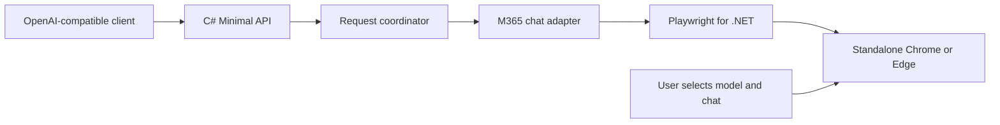

# Browser Coding Agent implementation plan

## Goal and first-release scope

Build a .NET 10 ASP.NET Core Minimal API that exposes an OpenAI-compatible text chat interface backed by the Microsoft 365 Copilot browser chat box.

The server opens a visible, standalone Chrome or Edge window. The user signs in and manually selects the model, chat session, and other Copilot settings. Automation only enters text, clicks Send, observes the resulting answer, and returns it to the API caller.

Start with one browser, one bound tab, one active conversation, and one request at a time. Additional browser providers belong behind the same adapter later.

## Browser integration decision

Use `Microsoft.Playwright` directly from C# rather than Playwright MCP for the first implementation.

Both support standalone browser windows. Direct Playwright provides the required browser control within the C# process; MCP would add a separate server and tool protocol for the same operations. No LLM is needed to choose browser actions.

Launch with `Chromium.LaunchPersistentContextAsync`, `Headless = false`, and configurable `Channel = "chrome"` or `"msedge"`. Use a dedicated persistent profile so sign-in survives restarts. Playwright documents that the same profile cannot be shared between running browser instances and advises against automating the default Chrome profile.

Do not use WebView2 or an embedded browser. Do not install or replace the user's browser automatically. Keep a narrow browser adapter boundary so an MCP transport can be introduced later if a concrete need appears.

## Architecture



Use one application project with folders for endpoints, contracts, configuration, browser lifecycle, and providers. Add one test project. Avoid splitting into multiple production assemblies initially.

- **API endpoints:** Validate requests, map JSON contracts and errors, return completion results.
- **Request coordinator:** Own the single-request gate, deadline, cancellation, and submission state.
- **Browser session:** Own Playwright, the persistent context, the bound page, and readiness state.
- **M365 chat adapter:** Locate the composer and Send button, submit once, identify the new answer, and determine completion. Keep all M365 DOM assumptions here.

Proposed layout:

```text
src/BrowserCodingAgent.Api/
  Program.cs
  Endpoints/
  Contracts/
  Configuration/
  Browser/
  Providers/M365/
  appsettings.json
tests/BrowserCodingAgent.Tests/
  Fixtures/
```

## API contract

Implement a documented subset of Chat Completions compatibility, rather than claiming full OpenAI API parity.

| Endpoint | First-release behavior |
| --- | --- |
| `POST /v1/chat/completions` | Submit text to the bound chat and return the completed assistant answer. |
| `GET /v1/models` | Advertise one stable alias, `m365-active`, representing the manually selected browser model. |
| `GET /health/live` | Report whether the API process is running. |
| `GET /health/ready` | Report whether the browser and composer are usable; include a reason when not ready. |

The required `model` field must match the configured alias. It does not change the model in the browser. Return the alias in completion responses without claiming to know the underlying model.

Initially support `stream: false`, `n: 1`, and textual message content. Return standard completion fields: `id`, `object`, `created`, `model`, `choices`, assistant `message`, and `finish_reason`. Omit token usage because the UI does not provide reliable token counts.

Unsupported features receive a clear 400 error before any browser action: streaming until its milestone, tools/function calling, images, audio, forced JSON schemas, multiple choices, and generation controls that cannot be enforced through the UI. Document optional fields that are accepted only at their defaults.

Use OpenAI-style error envelopes with `message`, `type`, `param`, and `code`. Suggested HTTP mapping: malformed/unsupported input 400, busy or changed conversation 409, browser/login unavailable 503, upstream UI failure 502, answer deadline exceeded 504.

## Conversation semantics

The existing browser conversation supplies history. The initial API mode therefore submits only a single new user message per request, with a single text part or string. Reject other message histories explicitly rather than silently dropping system instructions or replaying turns into the active chat.

This is a deliberate first-release limitation: clients that resend full conversations or require tool calls will need a later conversation-mapping milestone before they work as coding agents. OpenAI wire formatting alone does not provide those semantics.

Bind to one identifiable M365 tab; never assume the foreground tab is the target. The user can change the selected chat between requests. Capture the conversation identity at request start and detect changes during processing. If multiple candidate tabs exist, require an explicit configured target rather than guessing. Avoid navigating away from a user-selected chat after startup.

Do not overwrite a nonempty composer, send into an already-generating chat, or automate model selection. Mark these conditions as not ready/busy. Users should leave the bound chat untouched during an active API request.

## Send and wait behavior

Treat submission and answer observation as separate operations:

1. Validate the API request and acquire the single-request gate. Reject a concurrent request with 409; no queue initially.
2. Check login, bound tab, conversation identity, empty composer, and idle chat.
3. Record existing message identities and answer state so an old answer cannot be returned as the new result.
4. Fill the composer, preserving newlines and code. Verify the entered text and that exactly one Send button is actionable.
5. Click the actual Send button once. Do not press Enter to submit. Bound browser operations by the remaining response deadline; do not attach a wait for the answer, page load, or network idle to submission. Use Playwright's navigation-wait opt-out where supported by the pinned version; still await click dispatch and actionability.
6. Start the separate answer watcher. Confirm submission using the new user turn and/or generation indicators, and correlate the new assistant turn with it.
7. Poll until the matching answer is complete, a known UI error appears, the conversation changes, the browser closes, cancellation occurs, or the overall deadline expires.
8. Extract only the new assistant answer, preserving code blocks and line breaks, and wrap it in the completion response.

"Do not wait" applies to the Send action. A non-streaming `/v1/chat/completions` request still awaits the answer. An immediate HTTP acknowledgement would need a separate, nonstandard asynchronous job API and is outside this first release.

`Chat.ResponseTimeoutMinutes` is the only configurable timing setting. It bounds the Playwright-to-M365 interaction, starting immediately before composer interaction and ending when the complete answer is collected. It does not cover manual sign-in or initial browser startup. Each browser operation uses the remaining budget so Playwright's per-action defaults cannot independently extend or prematurely end that budget.

Use capped exponential backoff for observations with internal defaults of 0.5, 1, 2, 4, then 5 seconds. Reset to the initial interval when progress appears. Each sleep and DOM operation must respect the remaining deadline, measured with a monotonic clock. Do not expose polling intervals, backoff multiplier, completion stability, or recovery timing as configuration.

Completion detection should use the site's explicit generation-finished signals together with stable answer content. Text being unchanged for a few seconds alone is insufficient: generation can pause. If no dependable completion signal exists, return an explicit failure/timeout rather than a potentially truncated successful answer. Validate the actual M365 signals during the browser spike.

Never automatically repeat a Send click after uncertain submission. Backoff retries observations, not prompts. A browser operation can fail or reach the deadline after the site has accepted the prompt.

If the client disconnects after submission, cancel that client's wait but retain ownership of the browser turn and observe it only within the original remaining response budget. On deadline expiry, perform no further timed recovery loop. If the turn is still active or uncertain, mark readiness as requiring manual recovery and reject new prompts until the chat is confirmed idle. Cancellation does not imply the UI stopped generating. There is no separate recovery timeout setting.

## Configuration

Proposed initial defaults; tune them after observing the real page:

```json
{
  "Browser": {
    "Channel": "msedge",
    "UserDataDirectory": ".local/browser-profiles/msedge",
    "StartUrl": "<configured M365 Copilot URL>"
  },
  "Chat": {
    "ModelAlias": "m365-active",
    "ResponseTimeoutMinutes": 10
  }
}
```

Document complete Edge and Chrome examples in README.md. For Chrome, use `Channel = "chrome"` and a separate profile directory, `.local/browser-profiles/chrome`. Resolve relative profile paths against the application content root. `UserDataDirectory` stores the browser's cookies and other profile data, preserving manual sign-in between restarts; it is not an M365 conversation selector. An ephemeral profile would require signing in again after restart.

Validate options at startup. Support normal ASP.NET Core configuration overrides, such as `Browser__Channel` and `Chat__ResponseTimeoutMinutes`. Keep the provider's locators centralized and allow targeted overrides for tenant/UI differences after the real DOM is inspected. Default the API listener to loopback. Exclude browser profiles and local diagnostic artifacts from Git; avoid logging prompt/answer contents by default.

## Implementation milestones and acceptance checks

### 1. Browser and M365 feasibility spike

Launch each configured browser in a standalone visible window with a dedicated profile. Verify manual sign-in persists across restarts and manual model/chat selection remains usable. Inspect the actual composer, Send button, message boundaries, and generation/error signals in the user's M365 UI. Record locator evidence without inventing selectors from documentation.

Acceptance: one prompt can be filled, sent by button click, and its complete answer read without returning a previous answer. Resolve unreliable completion detection before expanding the API.

### 2. Minimal API and browser lifecycle

Create the .NET 10 solution, configuration validation, browser lifecycle service, readiness endpoints, and `m365-active` model listing. Support graceful shutdown and clear browser-closed/login-required status. Pin dependency versions when implementing.

Acceptance: Chrome/Edge selection works, the application reports readiness accurately, and a browser restart does not erase saved sign-in.

### 3. Non-streaming chat completion

Implement DTOs, strict first-release input validation, the single-request coordinator, M365 adapter, separate Send/watch operations, configurable minute-based deadline, exponential backoff, and error mapping.

Acceptance: a compatible client can call the endpoint and receive the new assistant answer; concurrent requests cannot interleave; uncertain submission never triggers a second Send.

### 4. Reliability and compatibility verification

Use a local simulated chat page to exercise delayed starts, paused generation, repeated identical answers, explicit completion, UI failures, conversation switches, browser closure, timeouts, and disconnects after submission. Use a fake clock for backoff/deadline tests and in-process HTTP tests for JSON/error contracts. Verify multiline prompts and code extraction. Test with an OpenAI SDK client against the local base URL. Finish with manual M365 smoke tests, keeping real-account tests opt-in.

Acceptance: old or partial answers cannot be reported as completed new answers; recovery prevents cross-request contamination; documented limitations match actual validation.

### 5. Streaming and broader client support

Add `stream: true` using Chat Completions SSE framing, role/content chunks, a final finish reason, and `[DONE]`. Begin with documented buffered output if M365 rewrites in-progress text; only emit incremental DOM deltas after proving they are append-only. Keepalive comments can maintain the connection during long waits. Cover errors after headers have been sent.

Separately design full-history mapping and tool-call semantics before advertising compatibility with coding-agent clients. Responses API, automatic model/session selection, additional providers, attachments, parallel browser sessions, and a management UI remain later work.

## Distribution targets and GitHub Actions

Ship both a NuGet .NET tool (`BrowserCodingAgent`, executable `browser-coding-agent`, also runnable with `dnx`) and an npm package (`@liqngliz/browser-coding-agent`, runnable with `npx`). Names are proposed pending availability checks. Both packages use the same C# application, configuration, and matching release version.

Implement .NET tool packaging first, then a Node launcher around framework-dependent .NET publish output, following the inspected Tokenflow package. The npm launcher bootstraps a private ASP.NET Core 10 runtime on first invocation; the .NET tool uses the user's .NET installation. Both include the matching Playwright driver for supported platforms. See [PACKAGING.md](PACKAGING.md) for package layouts, launcher responsibilities, GitHub Actions jobs, and validation requirements.

Create `.github/workflows/ci.yml` for pull requests and main-branch pushes: build/test the application, create both packages, inspect their contents, and smoke-test the actual packages across supported platforms. Include an npm bootstrap test without a preinstalled .NET runtime. Upload artifacts without publishing.

Create `.github/workflows/release.yml` for version tags: verify the tagged commit, apply one version to both packages, test the built artifacts, and publish those exact artifacts to NuGet and npm through separate authenticated jobs after all required checks pass. Configure registry trust separately and support safe retries if only one registry publication succeeds.

For both installed distributions, resolve the default browser profile to a stable per-user location outside package caches. Keep existing explicit profile-path overrides and the single response-timeout setting. This distribution requirement supersedes using a package-relative `.local/` folder as the persistent profile default.

## Documentation consulted

- [ASP.NET Core Minimal APIs](https://learn.microsoft.com/en-us/aspnet/core/fundamentals/apis?view=aspnetcore-10.0)
- [OpenAI Chat Completions request and response contract](https://developers.openai.com/api/reference/resources/chat/subresources/completions/methods/create)
- [OpenAI Chat Completions streaming events](https://developers.openai.com/api/reference/resources/chat/subresources/completions/streaming-events)
- [Playwright .NET browser channels](https://playwright.dev/dotnet/docs/browsers)
- [Playwright .NET persistent browser context](https://playwright.dev/dotnet/docs/api/class-browsertype#browser-type-launch-persistent-context)
- [Playwright .NET click behavior](https://playwright.dev/dotnet/docs/api/class-locator#locator-click)
- [Microsoft Playwright MCP](https://github.com/microsoft/playwright-mcp)

M365-specific selectors and completion indicators have not been inspected yet; milestone 1 establishes them against the actual signed-in UI.
